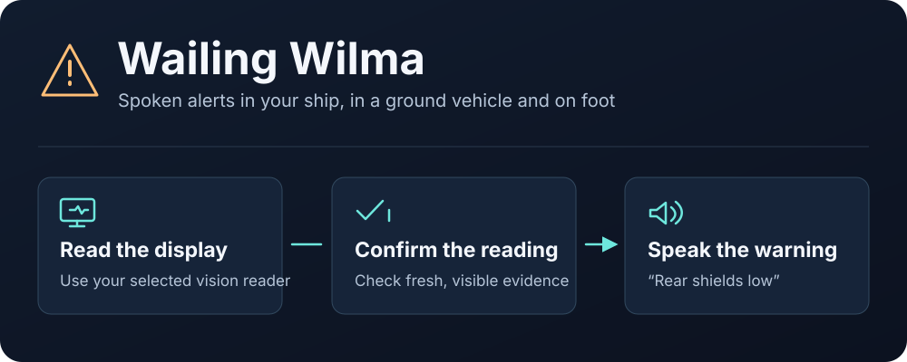

# Wailing Wilma

Wailing Wilma gives you spoken Star Citizen warnings through Wingman AI. It can watch your cockpit, an engineering terminal, a ground vehicle you’re driving or your personal HUD. A second PC can handle the image processing.

**[Download the Windows skill ZIP](https://github.com/Fowlplaychiken/Wailing-Wilma/releases/download/v0.1.81/wailing_wilma-0.1.81.zip)** · [Gameplay test results](docs/gameplay-tests.md) · [Offline benchmark chart](https://github.com/Fowlplaychiken/Wailing-Wilma/releases/download/benchmarks-2026-11-21.5/wilma-reader-results.html) · [All releases](https://github.com/Fowlplaychiken/Wailing-Wilma/releases)

This is a **preview**. In gameplay tests, local OCR read an incapacitation banner quickly. On ship terminals, even fast hosted readers missed visible faults or warned late. [Compare the API models](https://github.com/Fowlplaychiken/Wailing-Wilma/blob/NewRepo/docs/catalog-screen.md) · [Haiku and other readers on two ships](https://github.com/Fowlplaychiken/Wailing-Wilma/blob/NewRepo/docs/hosted-readers.md)

## Start using Wilma

1. Quit Wingman. Extract the skill ZIP into `%APPDATA%\ShipBit\WingmanAI\custom_skills`. You should see `wailing_wilma\default_config.yaml` directly inside that folder.
2. Open Wingman and enable **Wailing Wilma** for your Wingman. Select an image-capable vision model in Wingman, or choose a separate reader in Wilma’s settings.
3. Bring Star Citizen to the foreground and say **“Start Wailing Wilma.”** Ask **“Wailing Wilma status”** to hear what it can read. Say **“Stop Wailing Wilma”** when you’re done.

Windows and Wingman’s v3 skill API are required. Voice works on the gaming PC with one monitor. For an upgrade, keep your existing profile and extract the new ZIP over the skill folder while Wingman is closed.

## What you can ask for

| Say or do this | What happens |
| --- | --- |
| “Warn me about shields at 35 percent.” | Changes the low-shield threshold for this session. Saved defaults live in skill settings. |
| “Mute fuel warnings.” / “Unmute fuel warnings.” | Changes one category. “Mute Wailing Wilma” silences them all. |
| Look at your engineering terminal. | Wilma checks labeled gauges and messages such as a named component failure, a fire or a reactor countdown. |
| Switch on personal warnings in settings. | On foot, Wilma checks the enabled categories for suit oxygen, hydration, nutrition, blood loss, high pressure and incapacitation. Enable incapacitation to hear the exact warning shown on your own HUD. |
| “Wilma, you missed a cooler failure.” | Saves a private report for review. You can also report a wrong, repeated or late warning. |
| “Increase front shields.” | With the optional Star Citizen Computer engineering companion configured, opens a review for this one change. You confirm before it is sent. The standalone warning skill has no game-input driver. |

Ships and ground vehicles expose different displays. For a ship or rover you operate, Wilma can read visible shield, armor, hull and component indicators. Live seat telemetry helps it recognize when you stand up. **Watch engineering terminals on foot** lets you keep reading a console when you leave your seat. Without reliable seat data, Wilma depends on the visible scene and available game-log events.

By default, Wilma looks for two fresh readings before speaking. Glare, small text, a moving camera, a busy voice channel or a slow reader can cost you a warning. Check status to see what Wilma last recognized. It won't treat an unreadable gauge as zero.

## Choose where images go

| Vision reader | What to enter in Wilma’s settings |
| --- | --- |
| **Wingman’s configured model** | Uses your Wingman’s existing vision setup. |
| **Ollama** or **OpenAI-compatible server** | Enter the image-capable model’s name and the server’s `/v1` address. On a second PC, use that PC’s reachable address. |
| **Local CPU reader** | Choose **OpenAI-compatible server** and model `wilma-terminal-ocr` for engineering component failures and reactor countdowns. Its optional on-foot mode reads the English “You Are Incapacitated” suit warning. [Download reader](https://github.com/Fowlplaychiken/Wailing-Wilma/releases/download/terminal-ocr-v0.1.81/wilma-terminal-ocr-0.1.81.zip) · [Setup](https://github.com/Fowlplaychiken/Wailing-Wilma/blob/NewRepo/terminal_reader/README.md) |
| **OpenRouter** | Enter a vision model ID and store the API key under `openrouter` in Wingman Secrets. Your plan determines the cost. |
| **Local Waterfall bridge** | Use a configured Waterfall Main listener on the same PC, model `waterfall`, and its bridge secret name. Select only routes you want to receive images. [Waterfall setup](https://github.com/Fowlplaychiken/SC-Wingman-API-Waterfall) |

Wilma captures the foreground game window and sends images to the reader you select. It does not save screenshots. Keep keys in Wingman Secrets and use HTTPS on untrusted networks. To try the reader without starting the game, choose **Video playback (test)** and play gameplay in a foreground Chrome or Firefox window. Switch back to **Star Citizen** before playing.

To build the ZIP from source, run `python build.py --out <new-folder-outside-the-repository>`. [Source](https://github.com/Fowlplaychiken/Wailing-Wilma) · [Credits](NOTICE.md) · [License](LICENSE)
