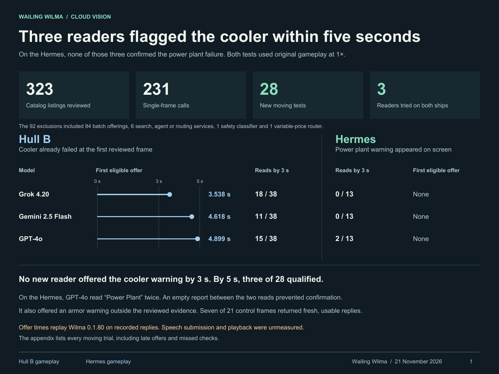

# Screening the cloud vision catalog

**Three of 28 additional readers qualified the Hull B cooler warning within five seconds. None confirmed the Hermes power plant warning.** Grok 4.20 made the earliest Hull B offer at 3.538 s. The cooler was already visibly failed when that clock started. The Hermes recording includes visible onset. [Hull B gameplay](https://www.youtube.com/watch?v=pOfxidINFvk&t=110s) · [Hermes gameplay](https://www.youtube.com/watch?v=6JgvriGCOr4&t=565s)

## From one frame to two moving trials

The screen covers OpenRouter's interactive image-to-text catalog under its default provider routing. A model that missed the cooler on this frame may still read a different display well. Direct streaming services remain untested. [Provider routing](https://openrouter.ai/docs/guides/routing/provider-selection)

### Does routing to a faster provider help?

On the same 20 Hermes frames, latency sorting reduced Gemma's median reply from 2.318 s to 1.541 s. It still missed all 13 power plant readings. GPT-4o read two of 13 with default routing and five with latency sorting. Its median reply was 2.172 s and 2.244 s respectively. The five correct replies identified different parts of the terminal, so Wilma never confirmed the warning. No arm produced an eligible warning. All 32 requests had reported costs, totaling $0.09552. [Matched routing results](reader-trials.csv)

The OpenRouter inventory contained 323 image-to-text listings. Each of 231 interactive listings received one copy of the same reviewed 1440p Hull B frame. The other 92 comprised 84 asynchronous batch offerings, six search, multi-agent or automatic routing services, one safety classifier and one router with unspecified or variable pricing. The supplier supplied no endpoint latency values in this inventory. [OpenRouter model catalog](https://openrouter.ai/api/v1/models)

Of the 231 calls, 77 returned parseable reports, five returned invalid text, 52 ended in reader errors and 97 yielded no usable reply at the five-second cutoff. Thirty-five named the cooler correctly within three seconds. Seven were among the original 42 models and 28 were newly tested. A single API call times the request and response. Capture and encoding precede that clock. It gives one observation per listing.

All 28 new qualifiers then ran on the full Hull B window. The original player ran at normal speed with one scheduled frame per second. All seven cohorts matched the same 41 reviewed 1440p frames, including 38 with a visible cooler failure. Five seconds was the request deadline and a busy reader skipped its next slot. All scheduled positives count toward the frame scores. [Earlier 42-model moving comparison](hosted-readers.md)

Wilma 0.1.80 replayed the recorded capture and response times in order. It needed two distinct confirming reads in a consistent view, each under three seconds old. **First offer** is when the released policy would have a warning ready for an available speech queue. No speech was submitted or played. A different request cutoff could change which frames the reader sees.

## The three readers that qualified within five seconds

| Reader | Hull B hits by 3 s / 5 s¹ | First cooler offer | Hermes hits by 3 s / 5 s² | First power plant offer | Fresh Hermes controls | Hermes USD (priced / sent) |
|---|---:|---:|---:|---:|---:|---:|
| Grok 4.20 | 18 / 18 | 3.538 s | 0 / 0 | None | 1/7 | $0.02715295 (7/7) |
| Gemini 2.5 Flash | 11 / 11 | 4.618 s | 0 / 0 | None | 3/7 | $0.0067275 (9/9) |
| GPT-4o | 15 / 15 | 4.899 s | 2 / 2 | None | 3/7 | $0.0520375 (7/7) |

¹ Of 38 positive frames per model. ² Of 13 positive frames per model. All 20 Hermes frames matched the independent reference. Four controls came before onset and three after the terminal left the screen. The warning first became legible between 9:25.500 and 9:25.750. This tests transfer to a different ship and creator on a previously studied recording. [Hermes gameplay](https://www.youtube.com/watch?v=6JgvriGCOr4&t=565s)

GPT-4o named the power plant at 9:31 and 9:37. A parsed report at 9:34 supplied no failure, so the policy cleared its pending confirmation. Two earlier control frames produced an eligible “Armor critically low (0%)” warning 1.515–1.766 s after visible power plant onset. Armor was outside the reference labels. Across all three readers, seven of 21 controls returned fresh parsed replies, no control produced a power plant offer and no warning repeated.

## All 28 Hull B moving tests

Each hit names the failed cooler within the stated capture-to-response deadline. Median hit uses correct responses within five seconds. The offer clock begins at the first already-positive frame. A dash means no qualifying result. The control column counts fresh parsed replies out of three terminal-absent frames.

| Catalog model | Hits by 3 s | Hits by 5 s | First offer | Median hit | Controls | USD shown (priced / sent) |
|---|---:|---:|---:|---:|---:|---:|
| x-ai/grok-4.20 | 18/38 | 18/38 | 3.538 s | 1.704 s | 1/3 | $0.06958710 (20/20) |
| google/gemini-2.5-flash | 11/38 | 11/38 | 4.618 s | 1.663 s | 1/3 | $0.0110155 (20/20) |
| openai/gpt-4o | 15/38 | 15/38 | 4.899 s | 1.904 s | 1/3 | $0.1314775 (19/19) |
| openai/gpt-5.4 | 15/38 | 15/38 | 5.040 s | 2.084 s | 2/3 | $0.137610 (17/17) |
| unbiased/pareto-26.9 | 12/38 | 12/38 | 5.264 s | 2.470 s | 1/3 | $0.08597050 (14/14) |
| ~openai/gpt-mini-latest | 14/38 | 14/38 | 5.400 s | 1.926 s | 1/3 | $0.0390420 (16/17) |
| google/gemini-3-flash-preview | 11/38 | 13/38 | 5.478 s | 2.465 s | 1/3 | $0.0210410 (14/14) |
| openai/gpt-5.1 | 10/38 | 13/38 | 5.533 s | 2.533 s | 0/3 | $0.02917525 (13/13) |
| anthropic/claude-opus-4.8 | 13/38 | 13/38 | 5.582 s | 2.598 s | 1/3 | $0.319465 (14/14) |
| openai/gpt-6.2-astra | 6/38 | 10/38 | 5.645 s | 2.901 s | 1/3 | $0.3126732 (11/12) |
| unbiased/pareto-26.10-preview | 13/38 | 13/38 | 5.702 s | 2.661 s | 1/3 | $0.02067526 (14/14) |
| unbiased/pareto-26.10 | 13/38 | 13/38 | 5.718 s | 2.677 s | 1/3 | $0.02597537 (14/14) |
| perceptron/perceptron-mk1 | 11/38 | 11/38 | 5.853 s | 2.541 s | 1/3 | $0.00623685 (13/14) |
| openai/gpt-4o-2024-11-20 | 13/38 | 13/38 | 7.895 s | 2.171 s | 1/3 | $0.1216125 (17/17) |
| openai/gpt-4.1 | 16/38 | 17/38 | 7.988 s | 1.988 s | 1/3 | $0.098876 (18/18) |
| google/gemini-3.1-flash-lite-preview | 17/38 | 17/38 | 8.895 s | 1.812 s | 1/3 | $0.0151455 (20/20) |
| x-ai/grok-4.5 | 7/38 | 7/38 | 8.993 s | 2.177 s | 1/3 | $0.0491492 (8/13) |
| anthropic/claude-opus-4.5 | 7/38 | 12/38 | 9.774 s | 2.838 s | 2/3 | $0.248440 (14/14) |
| openai/gpt-chat-latest | 9/38 | 11/38 | 12.483 s | 2.527 s | 1/3 | $0.18861 (12/13) |
| openai/gpt-4.1-mini | 11/38 | 12/38 | 14.315 s | 2.533 s | 0/3 | $0.0197256 (14/14) |
| mistralai/pixtral-large-2502 | 4/38 | 8/38 | 25.432 s | 2.839 s | 0/3 | $0.099912 (11/11) |
| amazon/nova-lite-v1 | 15/38 | 15/38 | — | 1.819 s | 2/3 | $0.00445362 (19/19) |
| amazon/nova-pro-v1 | 14/38 | 14/38 | — | 2.261 s | 0/3 | $0.0501536 (16/16) |
| google/gemini-3.1-pro-preview | 2/38 | 6/38 | — | 3.228 s | 0/3 | $0.036792 (6/10) |
| openai/gpt-4o-mini | 9/38 | 11/38 | — | 2.543 s | 1/3 | $0.06535845 (13/13) |
| openai/gpt-4o-mini-2024-07-18 | 12/38 | 13/38 | — | 2.480 s | 0/3 | $0.07857390 (14/14) |
| openai/gpt-5.6-sol | 0/38 | 9/38 | — | 3.980 s | 1/3 | $0.1736902 (10/10) |
| qwen/qwen3-vl-235b-a22b-instruct | 4/38 | 8/38 | — | 3.037 s | 0/3 | $0.00572070 (11/11) |

Twenty-one of the 28 readers eventually qualified a cooler warning. Two repeated it once each after reporting a different view, `~openai/gpt-mini-latest` and `openai/gpt-4o-2024-11-20`. Only 24 of 84 controls returned fresh parsed reports. No false cooler offer or other unsupported offer arose on this recording.

Provider-reported charges came to **$0.611265903** for 121 of 231 single-frame calls, **$2.46615780** for 402 of 415 moving Hull B calls and **$0.08591795** for all 23 Hermes calls. Charges for the remaining calls are unknown. These results cover two recorded incidents and their reviewed controls.
