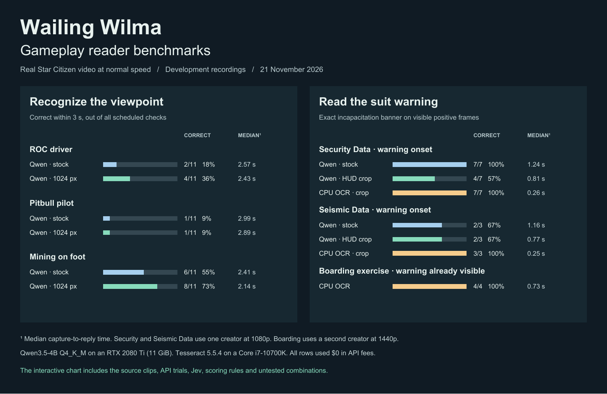
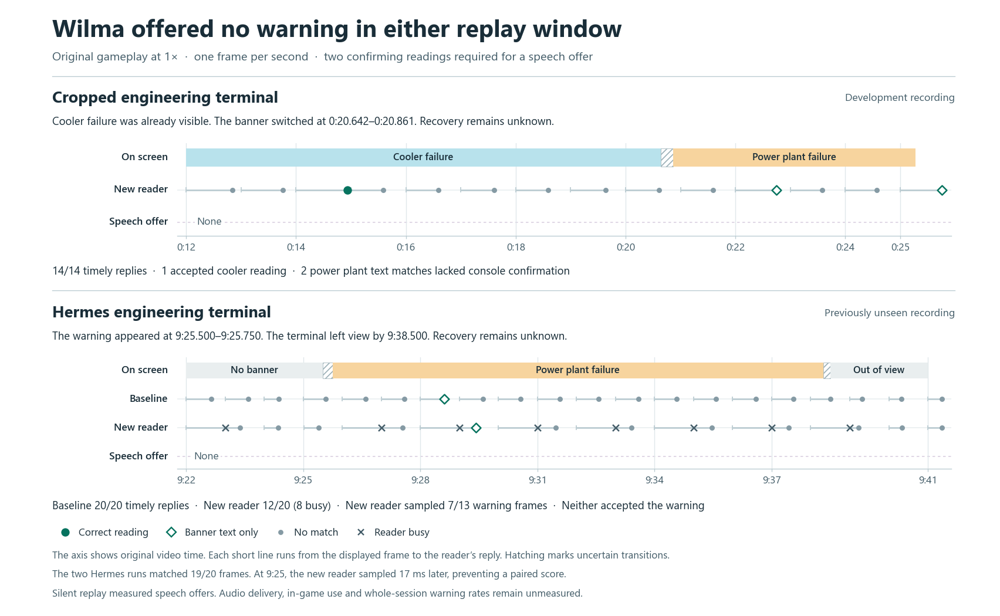
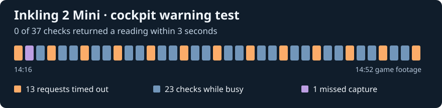

# Gameplay tests

These runs used real gameplay at normal speed. The tests used 2560 × 1440 unless a result specifies another resolution. Reviewers checked the visible HUD before comparing model replies. The deadline was three seconds per frame unless stated otherwise.

[Download the interactive benchmark chart](https://github.com/Fowlplaychiken/Wailing-Wilma/releases/download/benchmarks-2026-11-21.2/wilma-reader-results.html) and open it in your browser. It works offline. Search by model, task or reader combination to see the scoring rule, timing, recorded cost and which comparisons still need a run.

The [full comparison data](https://github.com/Fowlplaychiken/Wailing-Wilma/blob/NewRepo/docs/reader-trials.csv) includes local and hosted models, OCR and Jev trials, hardware, available costs, denominators and cases still awaiting a run. Compare rows with the same task and source. A planned run has no score.

## Local reader across three viewpoints

With Wilma 0.1.80’s stock Wingman image encoding, local Qwen3.5-4B Q4_K_M identified the correct viewpoint in 9 of 33 scheduled checks. Ten replies arrived within three seconds. The one wrong reply classified a close-up of the player’s handheld mining tool as an engineering terminal.

| Reviewed view, 11 scheduled checks each | Correct view by deadline | Timely replies | Expired requests | Checks while busy | Median age of timely replies |
| --- | ---: | ---: | ---: | ---: | ---: |
| Greycat ROC driver | 2/11 | 2 | 4 | 5 | 2.570 s |
| Drake Pitbull pilot | 1/11 | 1 | 5 | 5 | 2.987 s |
| Player mining by hand | 6/11 | 7 | 0 | 4 | 2.410 s |

Each original 2026 recording played for 20 seconds at 1× and 2560 × 1440. The scene was reviewed before inference at two-second intervals. All 33 native frame hashes matched on replay. Tests used the same general prompt on a GeForce RTX 2080 Ti (11 GiB) and Core i7-10700K, with $0 in API fees. Wilma accepted one ship fuel reading. This test scored only the viewpoint, so fuel accuracy, warning detection and audible delivery remain unmeasured. [ROC at 22:36](https://www.youtube.com/watch?v=zf5IcLx8ZOc&t=1356s) · [Pitbull at 2:27](https://www.youtube.com/watch?v=JGn9ezngXVc&t=147s) · [Hand mining at 12:32](https://www.youtube.com/watch?v=jXnK4j3vjEI&t=752s)

On the same ROC frames, forcing High image detail returned HTTP 400 on all 11 requests, leaving scene accuracy unscored. On a repeat, Wilma’s reader identified the first High request as exceeding the model context. Switching to stock encoding on subsequent frames produced three timely correct views, two expired requests and five busy checks. The three replies had a median age of 2.980 s. Both ROC encodings and the repeat yielded zero accepted gauges.

### What a smaller image changed

A second pass used a 1024 × 576 thumbnail before the same stock JPEG encoder, keeping the full field of view. The original 33 frame hashes, model, general prompt, two-second cadence and three-second deadline matched. Correct viewpoints by deadline rose from 9/33 to 13/33. Fourteen stock checks occurred while a request was in progress and nine requests expired. With the smaller image, 13 checks were busy and seven requests expired.

| View | Timely correct, stock → smaller | Median age of timely replies, stock → smaller |
| --- | ---: | ---: |
| ROC driver | 2/11 → 4/11 | 2.570 s → 2.429 s |
| Pitbull pilot | 1/11 → 1/11 | 2.987 s → 2.890 s |
| Mining by hand | 6/11 → 8/11 | 2.410 s → 2.136 s |

Completed general-prompt requests used 2,939 input tokens at stock detail and 2,390 with the thumbnail. The smaller arm was busy on the close-up where stock mistook the hand tool for a terminal. Both arms answered the same cockpit frame, but they proposed different gauges. Those values lack independent labels.

**Keep stock for warnings.** A separate paired check used the focused personal prompt on the original 1080p Onyx recording. Stock read all seven incapacitation frames. The thumbnail read six, missing the first visible banner. Both passed all four preceding quiet checks, and all 11 decoded frames matched. Median reply age improved from 1.243 s to 0.974 s. With two confirmations, the first warning offer moved from 24:38.747 to 24:39.974, **1.227 s later**. No speech ran. [Onyx at first visible banner](https://www.youtube.com/watch?v=q2YFjZ6XW4s&t=1475s)

## Engineering terminal

At 2:00 in the Hull B recording, a cooler failure was already visible. It remained visible at 28 scheduled checkpoints. A camera move hid the terminal at the last three. [Watch the source footage](https://www.youtube.com/watch?v=pOfxidINFvk&t=120s)

| Reader | Timely correct failure readings | Median age of completed replies | Correct warnings submitted | API charge |
| --- | ---: | ---: | ---: | ---: |
| Tesseract terminal reader · Intel Core i7-10700K | 13/28 (46.4%) | 764 ms | 1 | $0 |
| Warm Qwen3.5-4B Q4_K_M · GeForce RTX 2080 Ti | 0/28 | No reply by deadline | 0 | $0 |

The CPU reader submitted “Cooler failed” once. The fault was already on screen at the start. These figures measure detection of an ongoing fault with a silent speech adapter. They give neither time to first audible warning nor precision across ships. In a separate play of the same recording, hosted Gemini 3.5 Flash-Lite also submitted one correct cooler warning. Its 20 completions cost $0.0189 in total. On a fresh Hermes recording, both tested CPU reader configurations missed the power-plant failure.

## Cockpit, vehicle and on foot

**Inkling 2 Mini via OpenRouter.** Wilma tested the hosted model against 36 seconds of 1440p cockpit gameplay with visible warnings. At one check per second, it returned **0 timely readings in 37 checks**. Thirteen requests reached the three-second deadline, 23 checks occurred while a request was in progress, and one capture was missed. Wilma submitted no warnings. The provider returned no usage on these requests, so cost and recognition accuracy on completed replies are unknown. [Source footage at 14:16](https://www.youtube.com/watch?v=eJoqjCmYYls&t=856s)

Follow-up requests used the same two video times. The captured pixels matched across settings. At 14:27 the player's HUD showed a critical shield warning. At 14:31 the warning strip was blank. The earlier review recorded the video times without saving pixel hashes.

| Reader setting | Critical shield warning | Blank warning strip | Cost for both calls |
| --- | --- | --- | ---: |
| Hosted default reasoning, 15 s limit | Truncated (3.64 s) | Truncated (12.33 s) | $0.00053652 |
| Hosted reasoning off, 15 s limit | Warning missed (2.36 s) | Quiet (1.85 s) | $0.00026492 |
| Hosted reasoning off, 3 s limit | Expired (3.02 s) | Quiet (1.66 s) | At least $0.00031150 |
| Local IQ4_NL, reasoning off, 15 s limit | Expired (15.10 s) | Expired (15.01 s) | $0 API |

The local test used a GeForce RTX 2080 Ti (11 GiB) and a Core i7-10700K. Both requests timed out before the reader returned an answer, so recognition accuracy is unknown. Electricity is excluded from the API cost.

On the hosted service, disabling extra reasoning produced shorter, readable responses. Wilma recognized the cockpit and accepted no instrument readings from either view. The critical warning was missed even on the completed 2.36-second reply. The three-second repeat expired on that same warning. One blank strip cannot establish a false-alarm rate.

Eight reviewed checkpoints in a separate recording show two cockpit views, three on foot and three from an ATLS vehicle. Here the task was identifying the viewpoint. All three readers returned zero accepted instrument readings. [Watch the Aberdeen recording](https://www.youtube.com/watch?v=FtvXIOjns90)

| Reader | Correct viewpoint by deadline | Median completed reply age | Reported API charge for this run |
| --- | ---: | ---: | ---: |
| Gemini 3.5 Flash-Lite | 4/8 (50%) | 1.89 s | $0.0117 for 14 completions |
| Claude Haiku 5.5 | 1/8 (12.5%) | 2.48 s | $0.0032 for six completions; four expired calls had unknown billing |
| CPU terminal OCR | 0/8 | 0.285 s | $0 |

The terminal reader specializes in engineering-console banners and returned unknown on these views. Qwen had no matched run here. The hardware figures above exclude electricity.

## Reading the incapacitation banner at native resolution

Two 1080p recordings from the same creator show how a faster reply can still miss a warning. One shows the player recovering Security Data. The other shows a different engagement while recovering Seismic Data five days later. Before reviewing the second recording, the test fixed a lower-left crop from the first recording. Every arm used the same two-second sampling schedule, three-second maximum frame age and two-confirmation policy. [Security Data at 24:27](https://www.youtube.com/watch?v=q2YFjZ6XW4s&t=1467s) · [Seismic Data at 28:38](https://www.youtube.com/watch?v=prbwG5SAzg8&t=1718s)

| Reader | Security Data onset, 7 banner checks | First confirmed offer | Seismic Data onset, 3 banner checks | First confirmed offer |
| --- | ---: | ---: | ---: | ---: |
| Local Qwen3.5-4B, full frame and stock JPEG | 7/7 | 24:38.747 | 2/3 | None |
| Same Qwen reader and prompt, native HUD crop | 4/7 | 24:42.354 | 2/3 | None |
| Tesseract 5.5.4 on CPU, exact text line in the same crop | 7/7 | 24:37.245 | 3/3 | 28:56.234 |

In Seismic Data the banner was absent at 28:52.500 and visible at 28:52.750. Both Qwen arms read it at 28:54 and 28:58 but missed it at 28:56, so the policy withheld the warning. Across ten matching frames, the crop’s median reply age was 0.771 s and stock’s was 1.160 s. Both stayed quiet on the seven comparable pre-banner checks. Stock withheld one earlier frame whose pixels differed. The crop and OCR stayed quiet on all eight.

The CPU reader was tried **after** the Qwen results were known. Its first offer came 3.48–3.74 s after the banner appeared, using a second confirming frame that was 234 ms old. Median reply age was 253 ms. This diagnostic used a known personal HUD layout.

The optional CPU reader in terminal OCR 0.1.80 also checks the adjacent countdown label. Through the released Wilma JPEG client it read 7/7 Security Data warning frames, all nine later frames in that episode, and 3/3 Seismic Data warning frames. Thirteen matching quiet frames stayed quiet. One scheduled quiet frame had different pixels. With two confirmations, Wilma offered the Seismic warning at 28:56.454, 3.70–3.95 s after the banner appeared. On a different creator’s 1440p medical guide it stayed quiet on 22 matching pharmacy menu and instructional-overlay frames. Five generated controls covered an isolated subtitle, teammate text, respawn menu text, an unrelated timer and a centered overlay. None triggered. The boarding test below covers a different creator’s incapacitation HUD. Other languages and live voice delivery remain open. [Medical guide at the pharmacy](https://www.youtube.com/watch?v=U5a8aX0N5NQ&t=128s) · [Instructional overlay](https://www.youtube.com/watch?v=U5a8aX0N5NQ&t=510s)

Later in Security Data the banner remained visible through 25:34 and disappeared by 25:36. All three readers detected all nine visible-banner checks and stayed quiet on both subsequent checks. The camera changed and a clinic title followed. The footage establishes when the banner disappeared. Medical recovery remains unknown. All runs used local processing and silent policy replay, with $0 API charges. [Security Data at 25:18](https://www.youtube.com/watch?v=q2YFjZ6XW4s&t=1518s)

A local text-only follow-up used the confirmed CPU warning. The player asked “Wilma, what does my suit say?” and received “Your suit says you are incapacitated.” Asked “Can you tell if help’s on the way?”, Wilma replied “I cannot tell if help is on the way.” A broader “what’s wrong with me?” question sometimes failed to report the known status. The test generated no speech audio and sent no game input. Repeating the exchange with the packaged reader’s confirmed warning produced the same two answers. The first text reply took 28.5 s with the local conversation model initially unloaded. The follow-up took 208 ms.

### Boarding exercise on a second creator’s HUD

In Fried Chicken’s Star Citizen 4.6 recording, the player is down in a stairwell. The suit warning and death countdown stay visible while other players move. Before running OCR, a reviewer marked all seven one-second samples from 13:16 through 13:22 positive. The 1440p video played at normal speed. [Watch from 13:16](https://www.youtube.com/watch?v=M3_c2liJ28g&t=796s)

At Wilma’s two-second cadence, the CPU reader recognized **4/4 matched warning frames** within three seconds. Median time from frame presentation to reply was **727 ms**. The policy offered one warning at **13:18.720**, after two confirmations. The warning was visible when the clip began. Its onset, clearance, false-alarm rate and audible delivery remain unmeasured.

The first pass recognized all three matching frames. The sample at 13:16 landed 17 ms late and was excluded before OCR. A repeat matched all four. A separate pass recognized the three intervening seconds. All passes cover the same incident. The test used Wilma 0.1.80’s JPEG and HTTP reader with Tesseract 5.5.4 on a Core i7-10700K. The final OCR input used pixel-identical BMP over stdin so the footage stayed in memory. Timings include that conversion. API fees were $0.

## Personal warning false alarms

In version 0.1.80, Wilma can announce **You Are Incapacitated** on foot. In one original 1080p recording, local Qwen3.5-4B Q4_K_M read the banner in all seven reviewed frames from 24:35 through 24:47. All four preceding frames stayed quiet for incapacitation. On an RTX 2080 Ti, all 11 matching frames returned within the 3 s deadline. Median reply age was 1.243 s and the slowest was 1.784 s. Replaying those responses with the default two confirmations offered a single warning at 24:38.747. The run used the stock Wingman encoder, cost $0 in API fees and exercised one previously reviewed incident. Live speech and results on new recordings remain open. [Onyx Facility at 24:35](https://www.youtube.com/watch?v=q2YFjZ6XW4s&t=1475s)

On a different task, local Qwen3.5-4B read the on-foot HUD for blood loss and high pressure. The original prompt produced six false blood-loss readings in eight quiet Siege frames. Asking the reader to transcribe the visible alert fixed those six errors. With the revised prompt, 21/21 matched checkpoints across three recordings correctly stayed quiet. Two frames differed from the reviewed image, so they were excluded. None of these checkpoints contained either warning. Positive detection of blood loss or high pressure still needs a recording with that warning. [Siege of Orison](https://www.youtube.com/watch?v=56xX6cU26lI&t=1626s) · [Project Hyperion](https://www.youtube.com/watch?v=tKAXFuL98UU&t=303s) · [Personal HUD footage](https://www.youtube.com/watch?v=9w8nN3LFOFE&t=437s)
