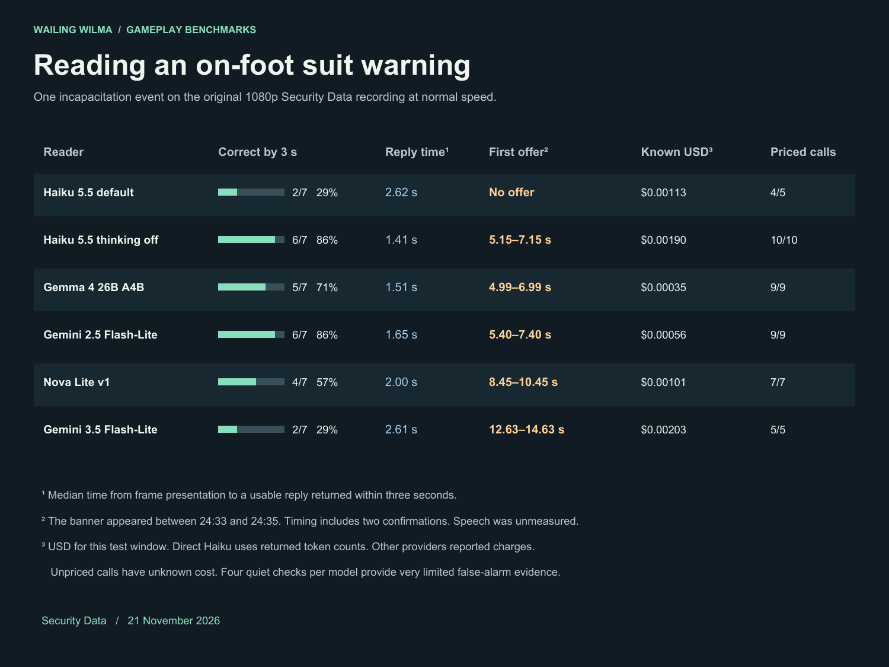

# Hosted readers on a suit warning

Haiku with thinking off and Gemini 2.5 Flash-Lite each recognized the incapacitation banner on six of seven scheduled warning frames. One frame differed from the reference and was withheld from every model. Haiku at its default setting recognized two frames and never confirmed the warning.

| Reader | Correct within 3 s | Median fresh reply | First confirmed warning after onset | Fresh quiet replies | Known USD | Priced calls |
| --- | ---: | ---: | ---: | ---: | ---: | ---: |
| Haiku 5.5 default | 2/7 (29%) | 2.619 s | No offer | 2/4 | $0.001134 | 4/5 |
| Haiku 5.5 thinking off | 6/7 (86%) | 1.412 s | 5.15–7.15 s | 4/4 | $0.001902 | 10/10 |
| Gemma 4 26B A4B | 5/7 (71%) | 1.512 s | 4.99–6.99 s | 3/4 | $0.000354 | 9/9 |
| Gemini 2.5 Flash-Lite | 6/7 (86%) | 1.645 s | 5.40–7.40 s | 3/4 | $0.000562 | 9/9 |
| Nova Lite v1 | 4/7 (57%) | 2.001 s | 8.45–10.45 s | 3/4 | $0.001011 | 7/7 |
| Gemini 3.5 Flash-Lite | 2/7 (29%) | 2.606 s | 12.63–14.63 s | 2/4 | $0.002026 | 5/5 |

The banner was absent at 24:33 and visible at 24:35. The interval includes the time for two confirming replies to arrive. Audio playback was unmeasured. Four quiet checks preceded the event. No fresh control reply raised the warning. Busy, late and withheld checks remain in the scheduled denominator. [Watch the gameplay at 24:33](https://www.youtube.com/watch?v=q2YFjZ6XW4s&t=1473s)

The six configurations used the same personal-warning prompt and the same game video decoded on Mordith. Ten of eleven frames matched the independent review exactly. The scoring wrapper initially failed after valid provider replies arrived. We rescored the recorded replies with the original release parser, including their original deadlines. Direct Haiku costs are estimates from returned token usage. The other costs came from the provider. A missing price leaves the total open.

On a separate run of the same recording, local Qwen3.5-4B recognized all seven scheduled positives and answered all four quiet checks. Its median reply time was 1.243 s on an RTX 2080 Ti. The local and hosted runs differed on one scheduled frame. [Local readers](gameplay-tests.md#comparing-unchanged-local-models) · [Time to synthesized speech](warning-delivery.md)
