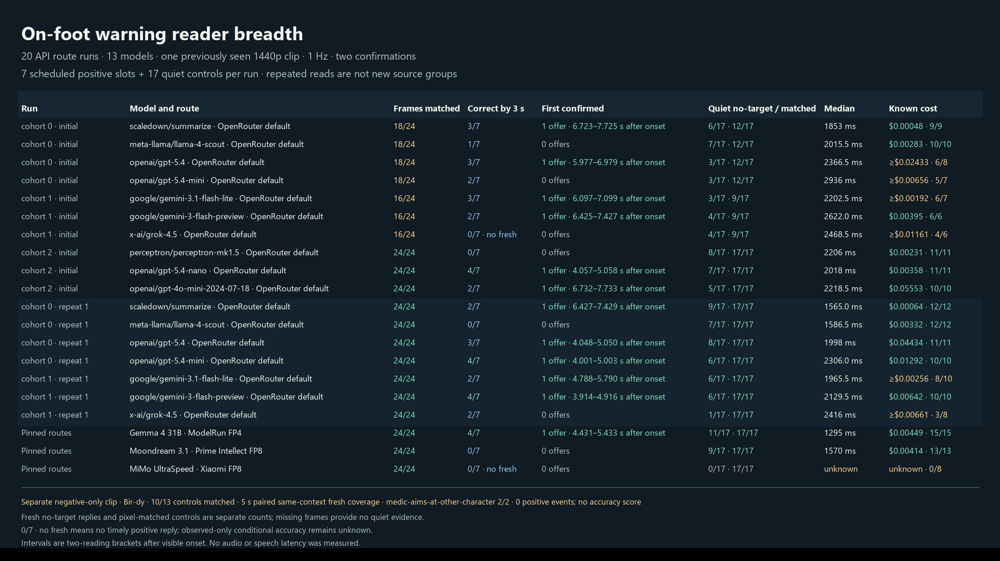

# Reading a suit warning during gameplay

The CPU reader confirmed the English incapacitation warning in **1.65–2.65 seconds** on a 1440p medical recording. It identified six of seven scheduled positive frames. The seventh arrived one video frame late. It stayed quiet on ten matching frames from a different creator, including two views of a medic treating someone else. Three scheduled controls could not be scored.

Direct Haiku and Gemini 3 Flash preview each confirmed the incident within five seconds in one run and took longer in another. The expanded comparison added 13 hosted models. Repeats used the same recording. These times end when Wilma confirms the warning. Time to hear the warning and the false-alarm rate during long sessions still need measurement.

All July cloud runs together sent 312 requests. Prices were available for 283, totaling $0.30443. Each chart row shows its own cost coverage. The CPU reader ran Tesseract 5.5.4 on a Core i7-10700K with zero API fees.

[Full offline chart](https://github.com/Fowlplaychiken/Wailing-Wilma/releases/download/benchmarks-2026-11-22.1/reader-breadth.html) · [All measurements](reader-trials.csv) · [Medical gameplay](https://www.youtube.com/watch?v=MyYzo6ZLsQ4&t=590s) · [Teammate treatment](https://www.youtube.com/watch?v=M1aUVtftoAo&t=22s)
