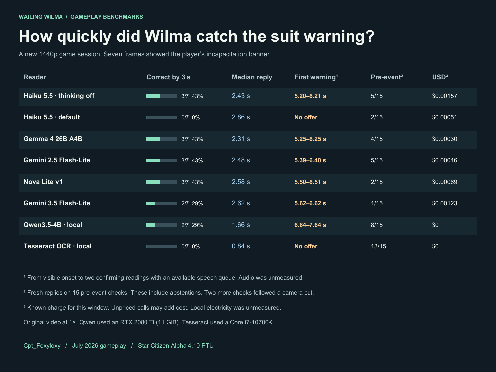
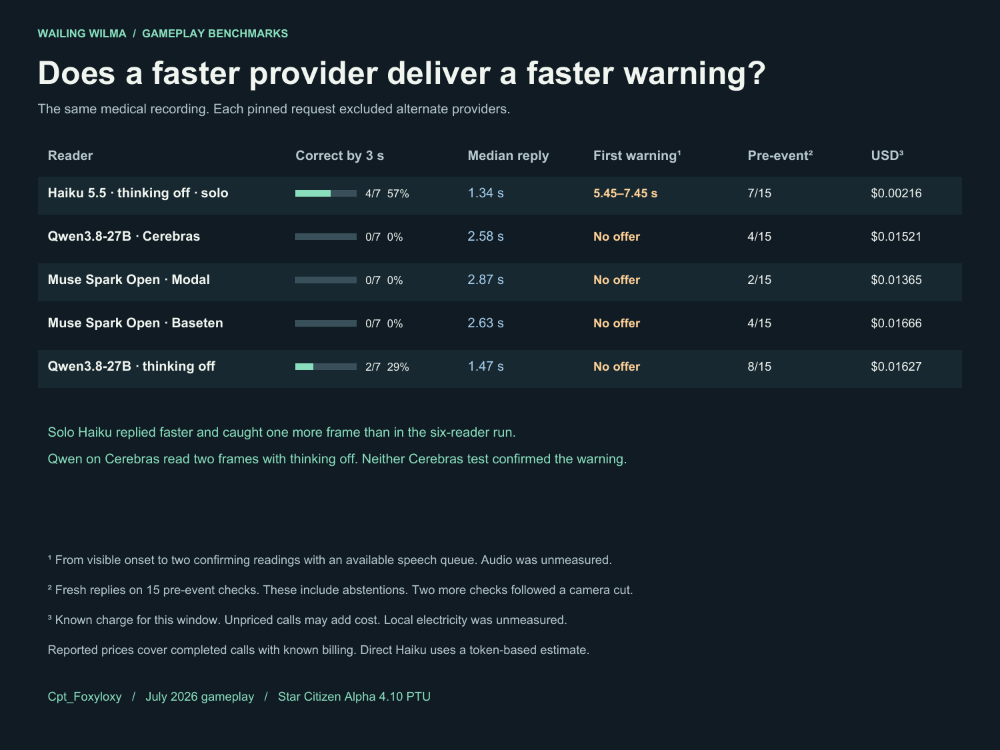

# Reading a new on-foot warning

Across 13 configurations, none confirmed the new medical warning within five seconds. Solo Haiku with thinking off recognized four of seven scheduled positives and replied in a median 1.34 s. Its second confirmation arrived 5.45–7.45 s after onset. Local Qwen recognized two frames and confirmed in 6.64–7.64 s. Local OCR missed all seven.

## Local and hosted readers

| Reader | Correct by 3 s | Median fresh reply | First confirmed warning after onset | Fresh pre-event / 15 | Fresh after cut / 2 | Known USD | Priced / sent |
| --- | ---: | ---: | ---: | ---: | ---: | ---: | ---: |
| Haiku 5.5 · thinking off | 3/7 (43%) | 2.43 s | 5.20–6.21 s | 5/15 | 0/2 | $0.00157 | 8/8 |
| Haiku 5.5 · default | 0/7 (0%) | 2.86 s | No offer | 2/15 | 0/2 | $0.00051 | 2/8 |
| Gemma 4 26B A4B | 3/7 (43%) | 2.31 s | 5.25–6.25 s | 4/15 | 1/2 | $0.00030 | 8/9 |
| Gemini 2.5 Flash-Lite | 3/7 (43%) | 2.48 s | 5.39–6.40 s | 5/15 | 0/2 | $0.00046 | 8/8 |
| Nova Lite v1 | 3/7 (43%) | 2.58 s | 5.50–6.51 s | 2/15 | 0/2 | $0.00069 | 5/8 |
| Gemini 3.5 Flash-Lite | 2/7 (29%) | 2.62 s | 5.62–6.62 s | 1/15 | 0/2 | $0.00123 | 3/8 |
| Qwen3.5-4B · local | 2/7 (29%) | 1.66 s | 6.64–7.64 s | 8/15 | 1/2 | $0 | Local |
| Tesseract OCR · local | 0/7 (0%) | 0.84 s | No offer | 13/15 | 2/2 | $0 | Local |

All six cloud configurations shared one player on the playback PC. Median time from frame presentation to starting each client ranged from 0.50 to 0.91 s. The two local readers ran together on the second PC. All seven positives matched the independent review in both runs. Two quiet frames differed in the local run and were withheld. Each hosted frame matched exactly.

Haiku costs are estimates from reported token usage. Other cloud costs use the provider’s reported charge. A local run has zero API fees. Prices cover this 24-second window. The counts next to each charge show how many calls had available pricing.

No reader in this comparison produced a wrong or duplicate confirmed warning. OCR returned an unknown scene on all seven positives and every matched control. Its final replies did not identify whether the heading or timer check failed. On two previous sessions it read the same banner quickly. [Earlier local and speech measurements](warning-delivery.md)

The six-reader bench initially passed a fractional millisecond timestamp to the warning policy, which requires whole milliseconds. We rescored its recorded replies with Wilma 0.1.81, the original deadlines and the player’s presentation clock. This required no repeat API calls. The single-reader control used the corrected benchmark.

## Single-reader and provider tests

| Reader | Correct by 3 s | Median fresh reply | First confirmed warning after onset | Fresh pre-event / 15 | Fresh after cut / 2 | Known USD | Priced / sent |
| --- | ---: | ---: | ---: | ---: | ---: | ---: | ---: |
| Haiku 5.5 · thinking off · solo | 4/7 (57%) | 1.34 s | 5.45–7.45 s | 7/15 | 0/2 | $0.00216 | 11/11 |
| Qwen3.8-27B · Cerebras | 0/7 (0%) | 2.58 s | No offer | 4/15 | 1/2 | $0.01521 | 8/8 |
| Muse Spark Open · Modal | 0/7 (0%) | 2.87 s | No offer | 2/15 | 1/2 | $0.01365 | 4/8 |
| Muse Spark Open · Baseten | 0/7 (0%) | 2.63 s | No offer | 4/15 | 0/2 | $0.01666 | 5/8 |
| Qwen3.8-27B · thinking off | 2/7 (29%) | 1.47 s | No offer | 8/15 | 1/2 | $0.01627 | 13/13 |

Solo Haiku returned 11 priced replies. Twenty of 24 frames matched, including six of seven positives. Its last matched clear frame was at 9:49, so its onset estimate spans two seconds. The six-way Haiku run matched every frame. Solo Haiku’s median reply fell from 2.43 s to 1.34 s, but the differing withheld slots make the two confirmation intervals unsuitable for a precise speed comparison.

Each hardware-pinned run disabled provider fallback. The three-reader test matched all seven positives and 16 of 17 controls. It cost at least $0.04551307 across 17 of 24 calls. Cerebras Qwen and Modal Muse hit the 512-token limit on at least one positive frame. Baseten Muse returned one fresh positive-window reply with no warning.

In a single-reader follow-up, Qwen used the same Cerebras route, 512-token limit, prompt and image settings with thinking off. All 13 replies finished without truncation. It recognized two of the seven positives and never confirmed the warning. This run also removed competing readers, so the change in median time cannot be attributed entirely to the thinking setting.

No wrong or duplicate warning became eligible in the single-reader or provider-pinned tests. Speech was unmeasured. [Cerebras model settings](https://inference-docs.cerebras.ai/models/qwen-3.8-27b) · [OpenRouter reasoning settings](https://openrouter.ai/docs/guides/best-practices/reasoning-tokens)

## What the player could see

The HUD was clear at 9:50. The incapacitation banner and countdown were visible from 9:51 through 9:57. A camera cut at 9:58 hid the banner. The footage does not establish when the player recovered. The original video played at 1× with one check per second at 2560 × 1440. This was a new recording by a creator already in the study. [Watch the gameplay](https://www.youtube.com/watch?v=MyYzo6ZLsQ4&t=586s)

The accuracy denominator includes all seven scheduled positive frames. The median covers fresh parsed replies, including misses. Local OCR can return an unknown scene. A busy reader, an expired request or an unmatched frame supplies no evidence about false alarms. One incident and 17 control frames cannot establish a false-alarm rate per hour.
