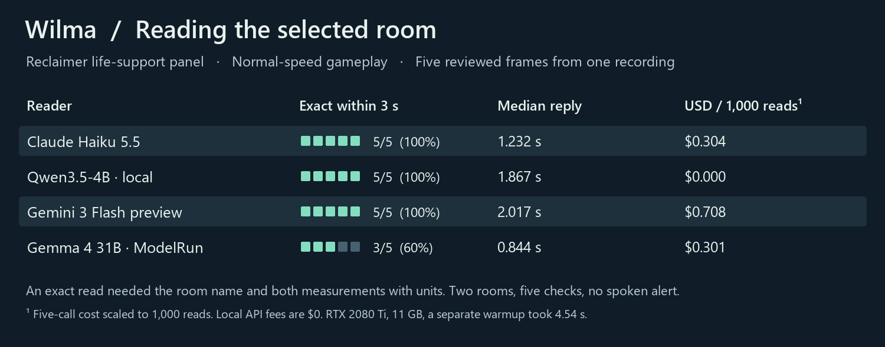

# Reading a room’s life support aboard a Reclaimer

Haiku and the warmed local Qwen both read all five sampled frames correctly. Haiku returned the same complete answer about 0.64 seconds sooner at the median. The fastest reader, Gemma, misread the pressure twice. One ship, two rooms and five checks supply an initial comparison.

| Reader | Room, pressure and temperature correct within 3 s | Median reply | API cost for 5 reads |
| --- | ---: | ---: | ---: |
| Claude Haiku 5.5 | 5/5 (100%) | 1.232 s | $0.0015195 |
| Qwen3.5-4B · local | 5/5 (100%) | 1.867 s | $0 |
| Gemini 3 Flash preview | 5/5 (100%) | 2.017 s | $0.0035425 |
| Gemma 4 31B · ModelRun | 3/5 (60%) | 0.844 s | $0.001507 |

The cockpit panel showed 0.9 ATM and 20.9 °C. The sub cargo bay showed 0.9 ATM and 6.3 °C, including two dimmed frames. The reader received the full frame with Wilma’s high-detail encoding and the same room-reading prompt on every route. It received no reference values. All models saw the same five native frames. These are room measurements, and the trial measured transcription. [Original cockpit view](https://www.youtube.com/watch?v=feQ6xpPdHsE&t=32s) · [Sub cargo bay](https://www.youtube.com/watch?v=feQ6xpPdHsE&t=40s)

Haiku used thinking off and low effort. Qwen3.5-4B Q4_K_M ran on an RTX 2080 Ti with 11 GB of VRAM. Its 4.54-second warmup is separate. Gemma’s first attempt stopped in the test adapter before transmission. The table uses its corrected five-call run, pinned to ModelRun FP4. The chart scales five measured calls to 1,000 reads. Anthropic cost uses returned token counts and standard rates, OpenRouter reported the actual charges, and local electricity was unmeasured.
