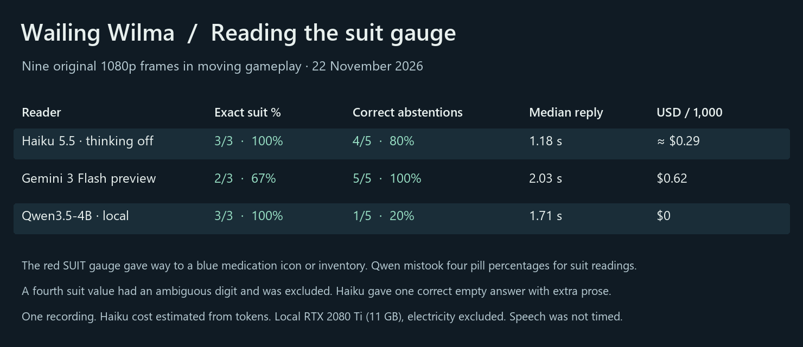

# Reading the personal suit gauge

In a July Star Citizen recording, a red **SUIT** readout showed 92%, 94% and 97%. A blue pill indicator then appeared in the same area. A reader that confuses the icons can report a suit problem while the player is looking at medication. [Watch the transition](https://www.youtube.com/watch?v=GNTwigP_lQo&t=5778s).

| Reader | Exact suit values | Valid empty answers during pills or inventory | Median reply | API cost for all 9 reads |
| --- | ---: | ---: | ---: | ---: |
| Haiku 5.5, thinking disabled | 3/3 | 4/5 | 1.179 s | $0.002643 estimated |
| Gemini 3 Flash preview | 2/3 | 5/5 | 2.026 s | $0.005591 reported |
| Qwen3.5-4B Q4_K_M, local | 3/3 | 1/5 | 1.714 s | $0 |

All three readers saw the same nine full frames at normal playback speed and replied within three seconds. One suit frame had an ambiguous digit, so reviewers scored its presence only. Haiku added prose to one correct empty answer. Gemini misread 94% as 84%. Qwen reported a suit percentage on every pill frame.

The footage establishes which indicator was visible. It provides no radiation dose, warning threshold or timing to a spoken alert. Local Qwen ran on an RTX 2080 Ti with 11 GB of VRAM. Its separate warmup took 5.74 seconds.
